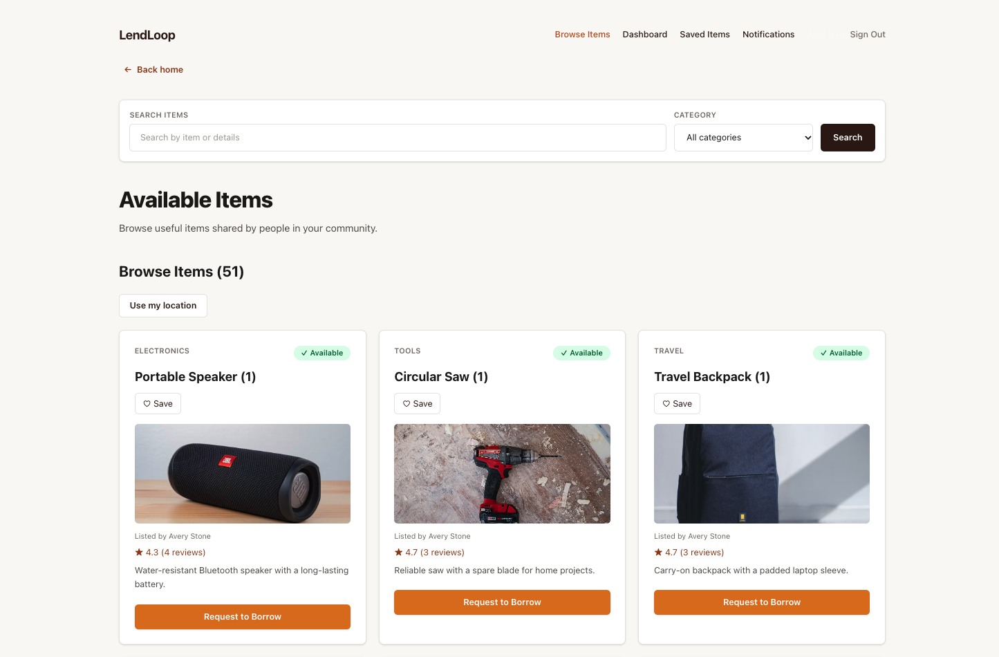
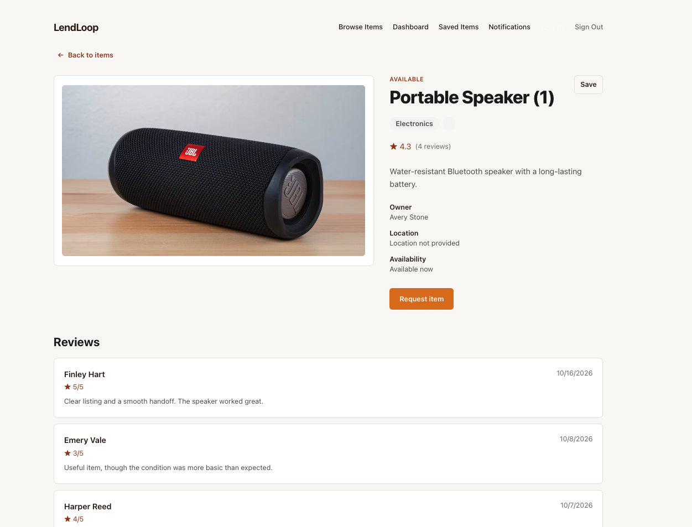
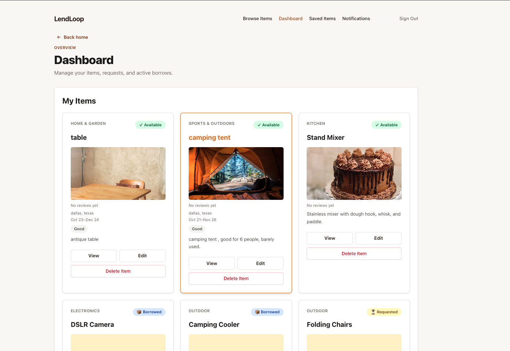
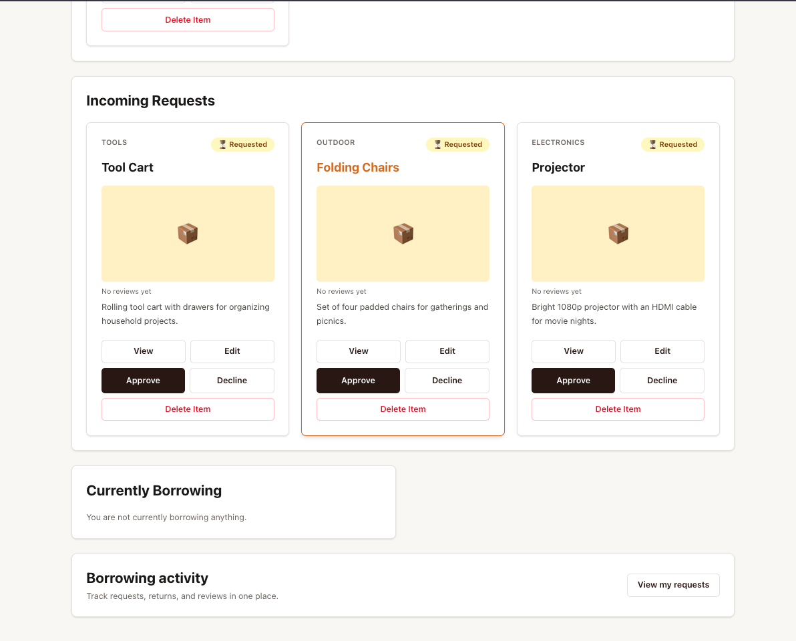
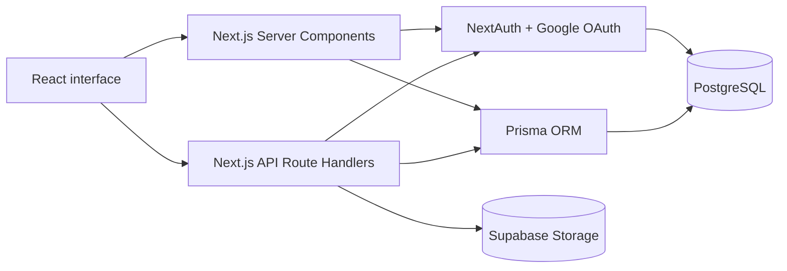
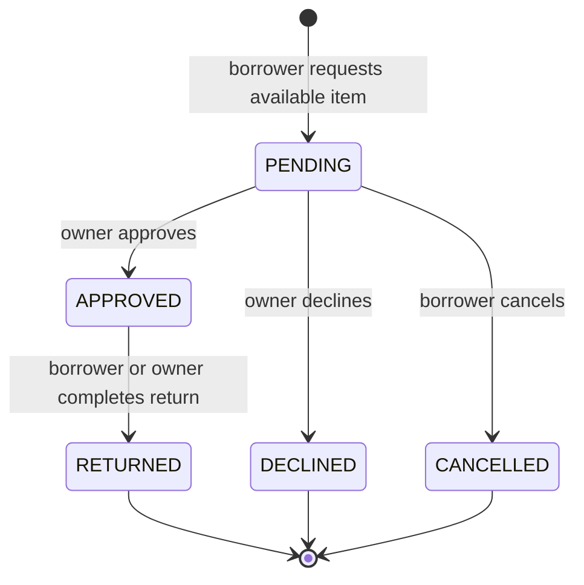

# LendLoop

LendLoop is a community lending application for listing items, requesting short-term loans, coordinating approvals, and recording returns.

- **Live application:** [lend-loop-bay.vercel.app](https://lend-loop-bay.vercel.app/)
- **Repository:** [github.com/sahithicheruku/LendLoop](https://github.com/sahithicheruku/LendLoop)

## Application Preview

The repository includes desktop captures of the running application:

| Browse Items | Item Details |
| --- | --- |
|  |  |

| Dashboard | Borrow Requests |
| --- | --- |
|  |  |

Additional captures are available for [Saved Items](docs/screenshots/saved-items.png) and [Notifications](docs/screenshots/notifications.png). See [`docs/screenshots/README.md`](docs/screenshots/README.md) for the screenshot mapping.

## Overview

LendLoop replaces informal borrowing conversations with a structured lending workflow. A signed-in user can publish an item with descriptive information, availability dates, location details, and up to three images.

Another user can browse listings, save items, submit a request, and follow the request through approval, borrowing, and return. Owners manage their own listings and requests, while reviews and notifications preserve useful history after a completed borrow.

## Features

### Item discovery and listing management

- Browse items with title search and category filtering.
- View item detail pages with descriptions, condition, availability, region, approximate distance, owner display name, images, reviews, and aggregate ratings.
- Create and edit listings with title, description, category, condition, city, region, and availability dates.
- Owners can upload, remove, and manage up to three item images.
- Owners can edit or delete their own listings, subject to active borrowing restrictions.

### Borrowing workflow

- Request available items from another user.
- Owners can approve or decline pending requests.
- Requesters can cancel their own pending requests.
- Approved items move into the borrowed state.
- The owner or approved borrower can complete the return flow.
- Request history preserves pending, approved, declined, cancelled, and returned records.

### Authentication and ownership

- Google OAuth through NextAuth.
- Prisma adapter persistence for users and OAuth accounts.
- JWT-backed NextAuth sessions with typed user IDs and roles.
- Server-side ownership checks for item edits, deletion, image operations, request decisions, cancellation, returns, and reviews.

### Favorites and notifications

- Save and unsave items for the current user.
- View saved items in a dedicated page.
- Receive notifications for requests, approvals, declines, cancellations, returns, and new reviews.
- Mark individual notifications or all notifications as read.

### Reviews and ratings

- A borrower can submit one review after a request reaches `RETURNED`.
- Ratings are integers from 1 to 5.
- Comments are optional and limited to 500 characters.
- Item pages show reviewer display name, rating, comment, date, average rating, and review count.
- Review notifications can be sent to the item owner.

### Location information

- Listings can include city, region, and optional coordinates.
- Item pages can show approximate distance when viewer location context is available.
- Exact coordinates and street addresses are not presented in the user interface.

## Routes

| Route | Purpose |
| --- | --- |
| `/` | Landing page |
| `/signin` | Google sign-in |
| `/items` | Shared browse feed with search and category filtering |
| `/items/[id]` | Item details, request actions, favorites, and reviews |
| `/items/new` | Create a listing |
| `/items/[id]/edit` | Owner-only listing management |
| `/items/saved` | Saved items |
| `/items/requests` | Borrow requests and completed-request review flow |
| `/items/borrowed` | Current borrowed items and returns |
| `/dashboard` | Owned items, incoming requests, and borrowing activity |
| `/notifications` | User notifications and read controls |

## Technology Stack

| Area | Implementation |
| --- | --- |
| Frontend | Next.js App Router, React, TypeScript, Tailwind CSS |
| Server rendering | Next.js Server Components and Client Components |
| API | Next.js Route Handlers |
| Authentication | NextAuth 4 with Google OAuth and Prisma Adapter |
| Database | PostgreSQL with Prisma ORM |
| Image storage | Supabase Storage through a server-side route |
| Deployment | Vercel |

## System Architecture



Server Components perform authenticated page reads where practical. Client Components handle filters, menus, galleries, forms, and request actions. Route Handlers validate sessions and input before changing Prisma records or uploading files.

## Lending Workflow

Item status describes the current listing state:

- `AVAILABLE` — the item can receive a request when its availability window permits.
- `REQUESTED` — a pending request exists for the item.
- `BORROWED` — an owner-approved request is active.

Borrow request status records an individual request:

- `PENDING`
- `APPROVED`
- `DECLINED`
- `CANCELLED`
- `RETURNED`



At item level, a pending request changes the item from `AVAILABLE` to `REQUESTED`. Approval changes it to `BORROWED`; decline or cancellation returns it to `AVAILABLE`; return also returns it to `AVAILABLE` while the approved request becomes `RETURNED`.

## Technical Implementation

### Authorization

`lib/auth.ts` configures Google OAuth, the Prisma adapter, JWT sessions, and typed session fields. Mutating route handlers call `getServerSession` through `getAuthSession()` and derive ownership from the authenticated session. Client-provided owner IDs are not accepted for item ownership.

### Database model

The Prisma schema models users, OAuth accounts, sessions, items, item images, borrow requests, favorites, notifications, and reviews. Important constraints include unique user email, unique OAuth provider-account pairs, unique favorites per user and item, unique requests per item and requester, one review per borrow request, and item-image uniqueness by item and storage path. Indexes support request status, favorites, image ordering, notifications, and review lookups.

Relations use the deletion behavior defined by the schema. Item deletion is additionally blocked by the API while an item is actively borrowed or has an approved request.

### Request lifecycle and reviews

The item route validates current state before processing request, approval, decline, cancellation, return, update, or delete actions. Review creation checks that the session user is the requester, the request is `RETURNED`, and no review already exists.

### Image handling

Images are uploaded through `/api/items/[id]/images/upload`. The route requires item ownership, accepts JPEG, PNG, and WEBP files, limits each file to 5 MB, and limits an item to three images. Objects are stored under a user and item path in the `item-images` bucket. The database stores the public URL and storage path. Removing an image deletes its database row and attempts to remove the corresponding Storage object.

### Location privacy

City and region are displayable listing information. Coordinates are optional and are used for approximate distance calculations. The UI does not expose exact coordinates or street addresses.

## Getting Started

### Prerequisites

- Node.js compatible with the project dependencies
- PostgreSQL
- Google OAuth credentials
- A Supabase project if image uploads are enabled

### Installation

```bash
git clone https://github.com/sahithicheruku/LendLoop.git
cd LendLoop
npm install
```

Create `.env.local` from `.env.example` and provide values for:

```text
DATABASE_URL
DIRECT_URL
GOOGLE_CLIENT_ID
GOOGLE_CLIENT_SECRET
NEXTAUTH_SECRET
NEXTAUTH_URL
NEXT_PUBLIC_SUPABASE_URL
NEXT_PUBLIC_SUPABASE_ANON_KEY
SUPABASE_SERVICE_ROLE_KEY
```

`SUPABASE_SERVICE_ROLE_KEY` is server-only and must never be exposed to the browser or committed.

Generate Prisma Client and start development:

```bash
npx prisma generate
npm run dev
```

When a local database is configured and a schema change is intentionally being developed, apply development migrations with:

```bash
npx prisma migrate dev
```

The repository defines a Prisma seed command. Review `prisma/seed.ts` and the target database before running it; the synthetic seed path deletes existing requests and items.

Useful validation commands:

```bash
npx prisma validate
npx tsc --noEmit
npm run lint
npm run build
```

## Deployment Notes

The production build runs `prisma generate && next build`. Vercel must contain the required database, NextAuth, Google OAuth, and Supabase environment variables. Google OAuth must allow:

```text
https://lend-loop-bay.vercel.app/api/auth/callback/google
```

Production migrations should be reviewed against the database migration history before applying them. This README does not prescribe a production migration command.

## Future Improvements

- Add automated unit and integration coverage for request transitions, authorization, and image cleanup.
- Replace remaining raw image elements with an appropriate image optimization strategy.
- Add clearer loading and error boundaries to more data-heavy pages.
- Reconcile the deprecated `middleware.ts` convention with the Next.js `proxy` convention after compatibility review.
- Add a license file and automated test coverage before treating the project as a reusable open-source package.

## License

No license file is currently included in the repository.
