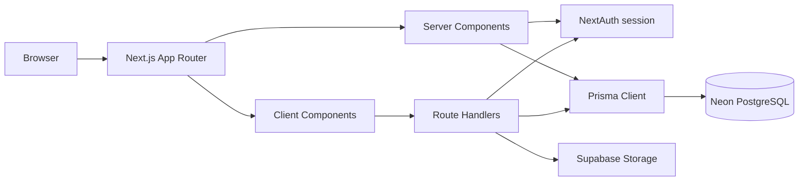
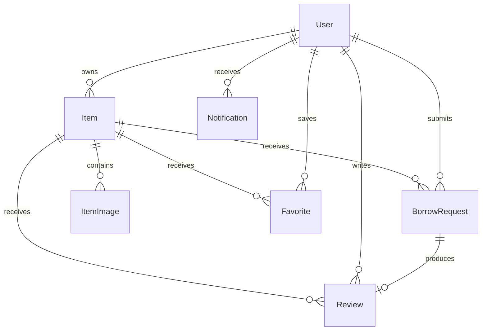
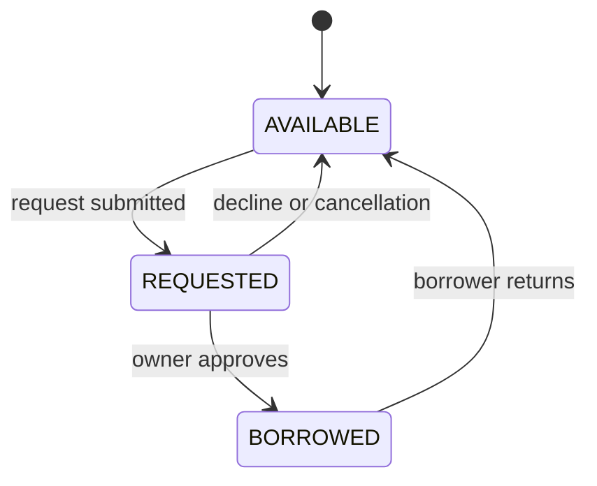

# LendLoop Architecture

LendLoop is a Next.js App Router community lending marketplace. Users sign in with Google, list items, browse available community items, request items, approve or decline requests, return borrowed items, save favorites, receive notifications, and review items after returned borrowing requests.

Production: <https://lend-loop-bay.vercel.app/>

## Stack

- Next.js 16 App Router, React 19, TypeScript, Tailwind CSS
- NextAuth with Google OAuth
- Prisma ORM with PostgreSQL on Neon
- Supabase Storage for server-side item image uploads
- Vercel deployment

## Application architecture



Server Components load authenticated data and enforce page access. Client Components provide interactive actions such as requests, approvals, returns, favorites, reviews, image selection, navigation menus, and back navigation. Route Handlers perform authenticated mutations and repeat authorization checks on the server.

Important frontend files include `app/items/page.tsx`, `app/items/[id]/page.tsx`, `app/dashboard/page.tsx`, `app/items/requests/page.tsx`, `app/items/saved/page.tsx`, `app/items/ItemsClient.tsx`, `app/items/[id]/ItemDetailClient.tsx`, `app/items/[id]/edit/EditItemForm.tsx`, and `app/components/NavigationLinks.tsx`.

## Authentication and authorization

NextAuth and Google OAuth are configured in `lib/auth.ts` and `app/api/auth/[...nextauth]/route.ts`. The server session supplies the authenticated user ID. New item ownership comes from the session, never from client input.

Server checks restrict item editing and deletion to owners, request approval and decline to owners, cancellation to requesters, returns to active borrowers, reviews to eligible borrowers, and favorites and notifications to their owning user.

## Database model



The Prisma models are `User`, `Account`, `Session`, `VerificationToken`, `Item`, `ItemImage`, `Favorite`, `BorrowRequest`, `Review`, and `Notification`.

Verified important constraints include unique provider accounts, unique item/requester pairs, one review per request, one favorite per user/item pair, and unique item image storage paths. Foreign keys preserve relationships and cascade behavior is defined in `prisma/schema.prisma`.

## Borrowing workflow



Request history separately records `PENDING`, `APPROVED`, `DECLINED`, `CANCELLED`, and `RETURNED`. Item status records the current lending state, including `AVAILABLE`, `REQUESTED`, and `BORROWED`.

## Browse, availability, and location

The Browse Items page loads available listings from all owners except the current user’s own listings. Search matches title, description, category, city, and region. The category dropdown is loaded independently from available categories, so it remains populated when a search has no results.

Availability dates determine whether an item is currently eligible. Public location display uses city, region, and approximate distance when the viewer grants browser location permission. Exact coordinates and street addresses are not shown publicly.

## Images, favorites, reviews, and notifications

Create and edit flows accept JPEG, PNG, and WEBP files up to 5 MB each, with up to three images per item. Upload and deletion routes are under `app/api/items/[id]/images/`; Supabase access is centralized in `lib/supabase-server.ts`. `ItemImage` stores URL, storage path, position, and item relationship.

Favorites are stored in `Favorite` and scoped by user. Reviews require a returned borrowing request, use a 1–5 rating, and allow an optional comment limited by the review flow. Notifications are user-specific and support individual and bulk read operations.

## Routes

- `/` landing page
- `/signin` Google sign-in
- `/items` shared browse feed and filters
- `/items/[id]` item details and reviews
- `/items/[id]/edit` owner-only editing
- `/items/new` listing creation
- `/items/saved` favorites
- `/items/requests` requests and review history
- `/items/borrowed` active borrowing and returns
- `/dashboard` owned items, incoming requests, borrowing activity
- `/notifications` user notifications

API areas include authentication, items, favorites, image upload/deletion, notifications, and request reviews.

## Folder structure

```text
app/       App Router pages, components, and route handlers
lib/       auth, Prisma, availability, distance, notifications, storage helpers
prisma/    schema, migrations, and seed logic
public/    static assets
docs/      project and screenshot documentation
```

## README screenshot package

The supplied visual references are stored in `docs/screenshots/`. The four primary screenshots are also assembled into `LendLoop-README-Screenshots.pdf`:

- Browse Items: `docs/screenshots/browse-items.png`
- Item Details: `docs/screenshots/item-details.png`
- Dashboard: `docs/screenshots/dashboard.png`
- Borrowing Workflow: `docs/screenshots/borrowing-workflow.png`

Additional references cover Notifications and Saved Items. The screenshots document the implemented UI and data visible during the authenticated capture session; they do not change the verified architecture described above.

## Validation and deployment

```bash
npx prisma validate
npx prisma generate
npx tsc --noEmit
npm run lint
npm run build
```

The production build has passed during the current work. ESLint has existing raw `` optimization warnings, and Next.js reports the middleware-to-proxy convention deprecation. No automated test suite was found in the reviewed files.
